# Визуальный прогон до и после исправлений

**Дата:** 18.11.2026. Скриншоты сняты Playwright + Chromium на локальной production-сборке: до — `origin/main` (`200d674`), после — ветка `audit/full-site-ux-visual-20261118`. Баннер cookies на скриншотах — состояние первого визита, до выбора.

Полный прогон — 67 маршрутов × 7 ширин (320–1920 px). В репозитории только репрезентативные пары; полный набор воспроизводится командой `node scripts/audit/site-crawl.mjs --base <url> --out <dir> --shots`.

## 1. Главная, телефон 390 px

| До | После |
| --- | --- |
| 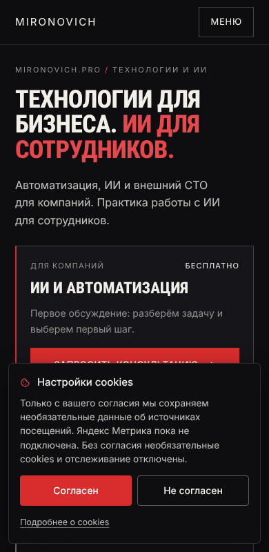 | 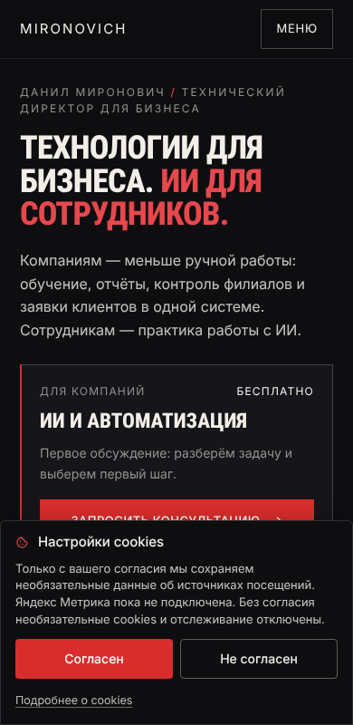 |

- Надзаголовок «MIRONOVICH.PRO / Технологии и ИИ» повторял логотип. Стало «Данил Миронович / технический директор для бизнеса»: посетитель сразу видит человека и роль.
- Подзаголовок «Автоматизация, ИИ и внешний CTO для компаний» → «Компаниям — меньше ручной работы: обучение, отчёты, контроль филиалов и заявки клиентов в одной системе». Вместо аббревиатуры — результат и знакомые задачи.
- Баннер cookies прижат к низу экрана и стал плотнее: примерно 225 px вместо 290. Текст и кнопки «Согласен / Не согласен» прежние.

## 2. Главная, десктоп 1440 px

| До | После |
| --- | --- |
| 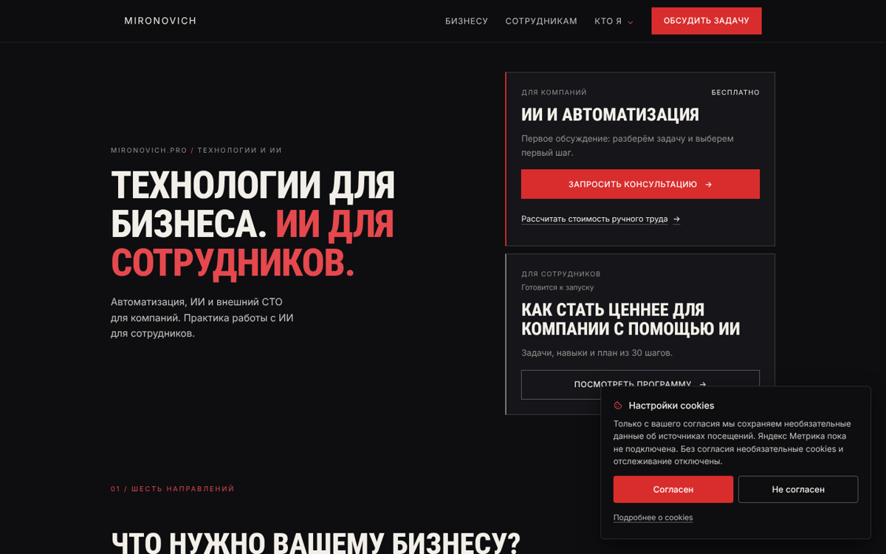 | 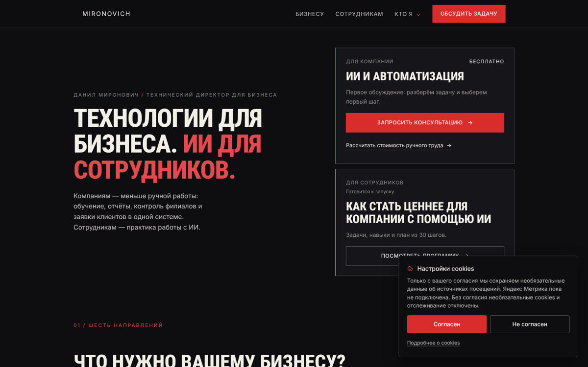 |

H1, две карточки аудиторий и фирменные цвета сохранены. Изменились только надзаголовок и подзаголовок.

## 3. Каталог «Что нужно вашему бизнесу?»

| До | После |
| --- | --- |
| 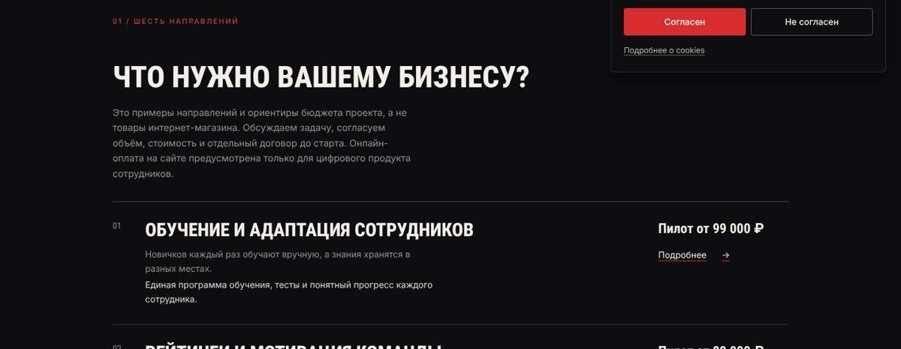 | 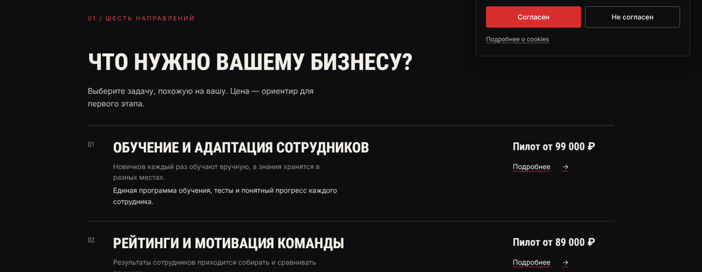 |

Блок начинался с оговорки «…а не товары интернет-магазина. Онлайн-оплата…». Теперь первой идёт фраза «Выберите задачу, похожую на вашу. Цена — ориентир для первого этапа». Оговорка нужна для ЮKassa и сохранена дословно — мелким текстом под списком.

## 4. Продукт для сотрудников, телефон 390 px

| До | После |
| --- | --- |
| 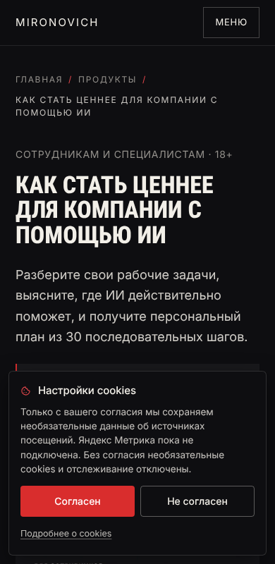 | 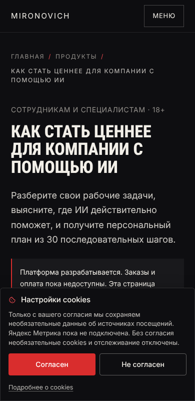 |

Строка «Заказы и оплата пока недоступны» у заголовка раньше уходила под баннер cookies. Теперь она видна на первом экране.

## 5. Обложка продукта

| До | После |
| --- | --- |
| 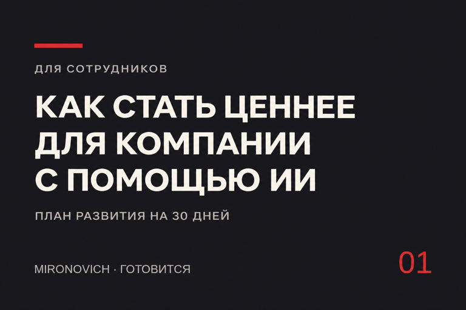 | 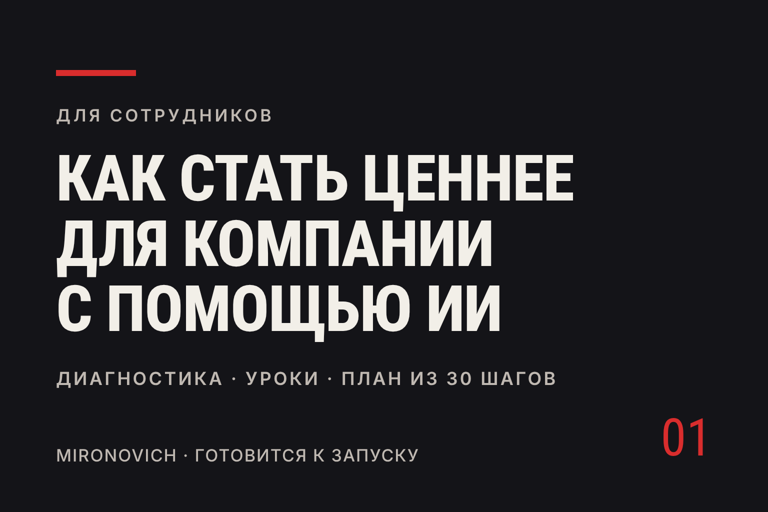 |

«План развития на 30 дней» противоречил описанию продукта на той же странице («не календарь на 30 дней»). Новая обложка — «Диагностика · уроки · план из 30 шагов», «Готовится к запуску». Она собрана из HTML с фирменными шрифтами сайта (`scripts/audit/render-product-cover.mjs`) и весит 105 КБ вместо 1,2 МБ.

## 6. Калькулятор ручного труда, телефон 390 px

| До | После |
| --- | --- |
| 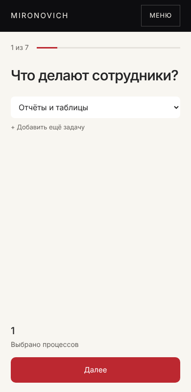 | 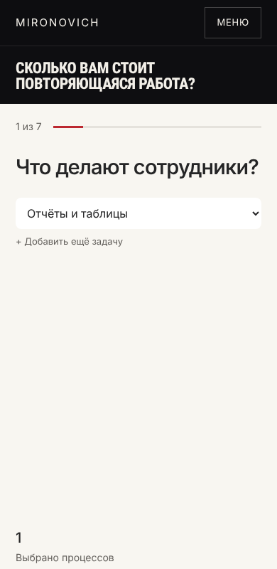 |

На телефоне заголовок был спрятан, и посетитель видел только «1 из 7 — Что делают сотрудники?». Теперь над мастером видно «Сколько вам стоит повторяющаяся работа?» (22 px). Сам мастер не менялся.

## 7. Услуги, телефон 390 px

| До | После |
| --- | --- |
| 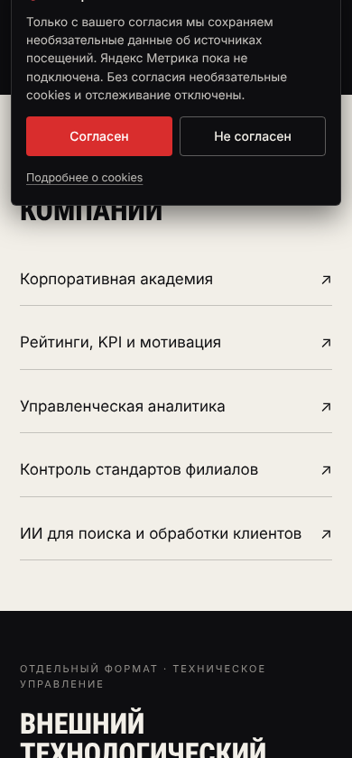 | 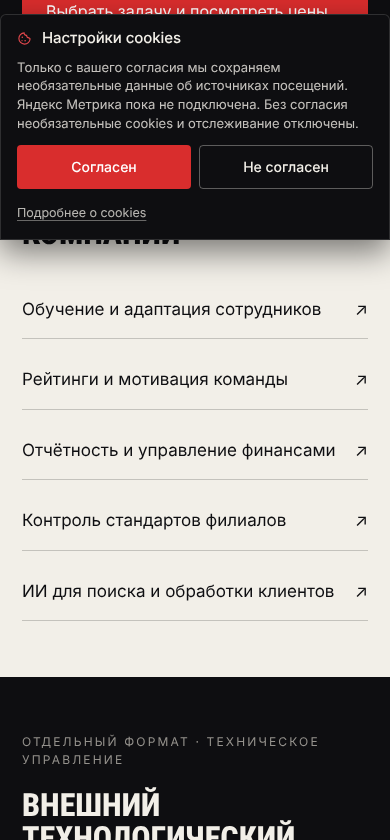 |

Решения в `/services` назывались иначе, чем на главной («Корпоративная академия», «Рейтинги, KPI и мотивация»). Теперь подписи совпадают с главной и `/solutions`. Внизу страницы вместо «Прежние специализации остаются доступны по своим адресам» — раздел «Отдельные услуги» с понятным описанием.

## 8. Подвал и мелкий текст

Все подписи 11 px (33 места: подвал, метки секций, «Автор», «Читать по теме», теги статей) увеличены до 12 px. Двустрочные ссылки в подвале получили вертикальный отступ и больше не сливаются на телефоне.

## Мобильная и десктопная версии — итог

- **Телефон (320–390 px).**
  - Горизонтальной прокрутки нет ни на одной странице — ни до исправлений, ни после.
  - Основные улучшения: видимый заголовок калькулятора и компактный баннер.
  - Остались: пустое поле в шаге калькулятора и частичное перекрытие кнопки консультации баннером при первом визите на экране 390×800.
- **Планшет (768–1024 px).** Сетка двухколоночная, без перекрытий и обрезки.
- **Десктоп (1440–1920 px).** Содержимое ограничено шириной 1080 px. На 1920 px по бокам остаются широкие поля — это осознанное решение для длины строки, а не дефект.
