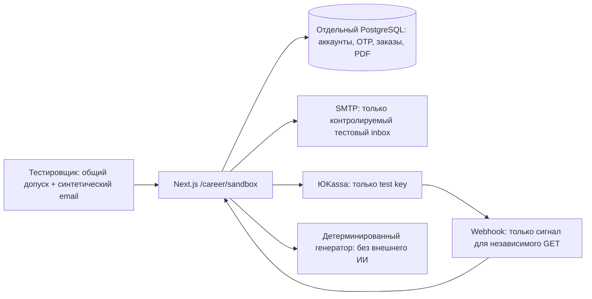

# Закрытый синтетический MVP: запуск и границы

Это инструкция для отдельного тестового окружения Railway, а не разрешение на
развёртывание или реальные продажи. `main`, production и B2B не используются.
Статус реализации и результаты: [отчёт](career-mvp-qa-2026-11-17.md).

## Схема

Файлы PDF сохраняются в PostgreSQL, выдаются только своему аккаунту через
`GET /api/career/report`, `private, no-store`. Публичных URL отчётов нет.
Синтетические ответы имеют только заранее определённые коды; свободный текст,
реальные email и передача данных внешнему ИИ не предусмотрены.

## Локальная проверка

Node.js 22.x, `npm ci`. Скопировать `.env.career.example` в игнорируемый
`.env.career.local` с правами 600. Заполнить случайные секреты через менеджер
секретов/локальное окружение; не включать значения в Git, логи или скриншоты.

1. Отдельный PostgreSQL, база `mironovich_career_test` или
   `mironovich_career_test_<суффикс>`. `CAREER_DATABASE_HOST` должен точно совпадать
   с host:port URL, `CAREER_DATABASE_NAME` — с именем базы. Нельзя подставлять
   существующую рабочую БД. `DATABASE_URL` приложения намеренно не используется.
2. Для локального `fixture`: фиктивные числовой ShopID и `test_` ключ, случайный
   `CAREER_FIXTURE_CONTROL_SECRET` (не настоящий ключ магазина). Только loopback.
3. `npm run career:migrate` — обе идемпотентные миграции одной транзакцией.
   Имя базы дополнительно проверяется внутри SQL до изменения таблиц.
4. `npm run career:fixtures` — локальные SMTP/платёжные заглушки; они живут только
   в памяти. После их перезапуска старые симулированные платежи недоступны.
5. `npm run career:test:integration` — реальные транзакции PostgreSQL и SMTP,
   заглушка провайдера. Тест создаёт только новые учебные аккаунты и не очищает
   произвольные базы. Лимиты намеренно действуют и для QA: 20 допусков/час,
   40 OTP/час, максимум 30 аккаунтов на тестовую базу.
6. `npm run career:build`, затем `npm run career:start` в другом терминале.
   Вход через `/career/sandbox`; email только `demo-…@example.invalid`.
7. `npm run career:test:browser` требует Playwright и Chromium
   `/usr/bin/chromium` в QA-машине. Браузер и все API вызовы ограничены loopback;
   Playwright — инструмент QA, не runtime зависимость сайта.

Платёжная кнопка fixture явно называется «Завершить локальную симуляцию».
Защищённое чтение OTP из локального SMTP fixture используется только тестами,
отсутствует в API Next.js и не допускается в удалённом режиме.

## Подготовка отдельного Railway sandbox — следующий согласуемый этап

Создать отдельные окружение и PostgreSQL с согласованным именем, не переиспользовать
production-сервис/БД. Образец переменных — `.env.career.example`; на Railway
секреты вводятся только через защищённые Variables. Локальный файл не загружается.

- `CAREER_SANDBOX_ENABLED=1`, `CAREER_ENVIRONMENT=synthetic-sandbox`,
  `CAREER_ONLY_SYNTHETIC=true`; Railway environment не должен называться production.
- `CAREER_APP_ORIGIN` — точный HTTPS origin отдельного `*.up.railway.app`.
  `mironovich.pro` не допускается серверной конфигурацией стенда. Команды
  `career:build/start` отключают необязательную Метрику во всём изолированном
  стенде, включая переходы между страницами. Обычная сборка сайта не меняется.
- `CAREER_PAYMENT_MODE=yookassa`; числовой ShopID существующего тестового магазина,
  перевыпущенный `YOOKASSA_TEST_SECRET_KEY=test_…`,
  `YOOKASSA_TEST_KEY_ROTATED=true`. Live ключ не поддерживается.
- `CAREER_SESSION_SECRET` минимум 40 символов, `CAREER_TESTER_SECRET` минимум 32;
  независимо сгенерированные случайные значения. Ротация первого отзывает сессии,
  OTP и подписи допуска. Общий допуск действует час, сессия 12 часов.
- SMTP от `support@mironovich.pro`: подтверждённые домен/поставщик, защищённые
  логин/пароль, TLS и `CAREER_SMTP_READY=true`. Во внешнем режиме все сообщения
  направляются только в `CAREER_SMTP_TEST_RECIPIENT`, а не на введённые адреса.
  Это контролируемый тестовый inbox владельца, не почта реального покупателя.
- Webhook тестового магазина: `/api/career/webhook`, события payment/refund.
  Его тело не является доказательством оплаты: статус, сумма, валюта, UUID,
  metadata и test=true проверяются самостоятельным запросом к API провайдера.
- Обычные команды build/start сайта не включают стенд сами; команды `career:*`
  требуют полностью валидную тестовую конфигурацию. Существующий release guard
  сохранён. Не задавать публичный production origin для обхода проверки.

Не выполнять эти действия на Railway без отдельного разрешения. После настройки
обязателен настоящий сквозной sandbox checkout/webhook/возврат: локальный fixture
не доказывает доступность API, корректность ключа или конфигурации магазина.

## Эксплуатационные задачи

`npm run career:cleanup` удаляет активные ответы, результат/PDF и прогресс через
30 дней после конца доступа; просроченные OTP спустя сутки, истёкшие/отозванные
сессии и устаревшие rate buckets. Флаг расходования анализа остаётся: удаление
отчёта не даёт нового анализа или возможности купить продление удалённого отчёта.
Планировщик этой команды ещё не развёрнут; его создание и мониторинг обязательны.
Сроки заказов, доказательств, событий и резервных копий утверждаются отдельно.

`npm run career:mail` обрабатывает до пяти готовых сообщений outbox. Отправка также
вызывается после заказа, проверки оплаты и возврата. Неудача повторяется не раньше
чем через минуту, максимум пять попыток; затем требуется оператор. Нужен регулярный
worker/cron, не публичный административный API. Уникальный ключ подавляет повторную
постановку одного уведомления, но SMTP не даёт гарантии exactly-once при сбое между
доставкой и фиксацией транзакции. Содержимое письма и OTP в логи не выводятся.

Первоначальные 90 суток — от выдачи доступа; продление — 12 календарных месяцев
от `captured_at` независимо проверенного платежа, без прибавления остатка.
Техническая ошибка генерации не расходует анализ; успешный результат и PDF
фиксируются атомарно. Параллельные запросы используют lease, повтор возвращает
сохранённый результат. Изменять ответы после успеха нельзя.

Обычный полный тестовый возврат запрашивается в семидневное окно по Москве,
не считая дня покупки. Время запроса хранится отдельно: отложенное подтверждение
можно завершить после закрытия окна. Пока возврат не завершён, новые покупки
заблокированы; доступ отзывается только после независимо проверенного succeeded.
В прототипе автоматизирован возврат последнего гранта и платежа без выданного
доступа; сложные цепочки, отменённый refund и специальные требования требуют
оператора. После возврата продления восстанавливается прежний невозвращённый
период. Не выдавать это ограничение за ограничение обязательных прав покупателя.

Логи Railway/SMTP, резервные копии, мониторинг, восстановление, доступ операторов
и удаления проверяются отдельно. Синтетические записи не делают законной обработку
реальных ПД на Railway. До закрытия [юридических блокеров](ai-career-approval-and-blockers-2026-11-17.md)
реальные регистрации, платежи и ИИ остаются запрещены.
