# Визуальная проверка PDF модуля безопасности (#42)

**Дата:** 18.11.2026 · **Сборка:** `node scripts/career/build-safety-materials.mjs` (Playwright 1.63.0 / Chromium 1243, poppler) · **Воспроизводимость:** `node scripts/career/check-safety-pdfs.mjs` — PASS для всех 11 файлов.

## Сводка

| Файл | Формат | Стр. | Шрифты встроены | Кликабельные источники | Оглавление со ссылками |
| --- | --- | --- | --- | --- | --- |
| safety-guide-a4.pdf | A4 595×842 pt | 28 | да | 23 из 23 | да, с номерами страниц |
| safety-guide-mobile.pdf | 110×196 мм (312×556 pt) | 76 | да | 23 из 23 | да, с номерами страниц |
| safety-workbook-a4.pdf | A4 | 31 | да | 6 источников + 1 учебная ложная ссылка (research.example) в задании 2 | да |
| safety-rules-memo-a4.pdf | A4 | 2 | да | — | не нужно |
| safety-rules-memo-mobile.pdf | 110×196 мм | 4 | да | — | не нужно |
| safety-checklist / data-matrix / prompts / manager-request / practicum / test (A4) | A4 | 3 / 4 / 4 / 5 / 11 / 6 | да | по месту | — |

## Что проверено и результат

| Критерий | Как проверяли | Результат |
| --- | --- | --- |
| Обрезанный текст | В сборке: ни один абзац, ячейка, промпт или заголовок не шире своего блока; иначе сборка падает | Нарушений нет |
| Шрифты | `pdffonts`: все шрифты встроены; основной текст — Inter, заголовки — Roboto Condensed (оба из `assets/blog-covers/fonts`), символы ✔ ✖ ◐ — DejaVu | Встроены. Chromium встраивает вариативные шрифты как Type 3: текст выделяется и ищется, но в старых просмотрщиках может выглядеть менее чётко |
| Контраст (WCAG 2.1) | Расчёт по формуле относительной яркости | Основной текст 16,8:1; серый текст 6,4:1; красные ссылки на кремовом 5,0:1; заголовки плашек 5,3:1 (после правки: было 4,45:1, затемнили до `#B02020`); шапка таблиц 16,8:1 |
| Читаемость на телефоне | Страница 110 мм при ширине экрана 390 CSS-px: кегль 12 pt ≈ 15 px на экране; заголовки 18 pt; таблицы — карточками, без горизонтальной прокрутки | Читается без увеличения. Скриншоты 06–08 и 10 сделаны при 150 dpi (≈ экран 2×) |
| Переносы | Автоматические русские переносы в тексте; без переносов в заголовках, оглавлении, первой колонке таблиц; неразрывные пробелы в «201 600 ₽», «10 %» и перед тире | Исправлен перенос «Зелё-ный» в узкой колонке; суммы не разрываются |
| Таблицы | Строки не рвутся между страницами; шапка повторяется на новой странице (A4); на телефоне — карточки «поле: значение» | В порядке |
| Номера страниц и оглавление | Номера в колонтитуле «N / всего»; страницы оглавления вычисляются по тексту PDF и перепроверяются после второй вёрстки | Совпадают |
| Ссылки | Тест считает URI-аннотации в PDF; все 23 источника реестра кликабельны в обеих версиях пособия | В порядке |
| Типографика кавычек | Вложенные кавычки „…“ внутри «…» (кроме текстов промптов, которые копируются дословно) | Исправлено |

## Скриншоты характерных страниц

| Пособие A4 | |
| --- | --- |
| 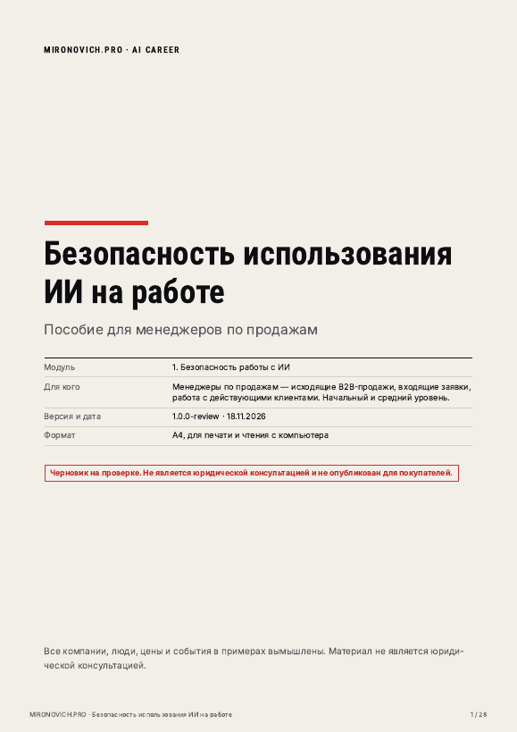 | 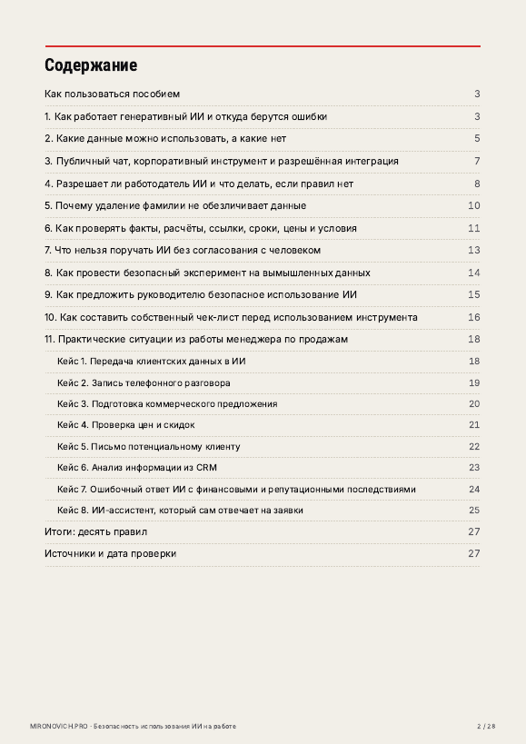 |
| 01 — титул | 02 — оглавление с номерами страниц |
| 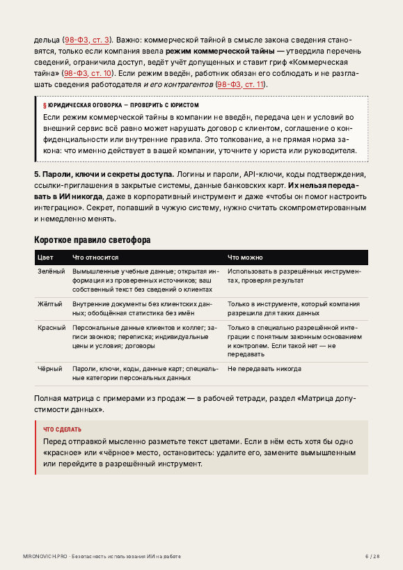 | 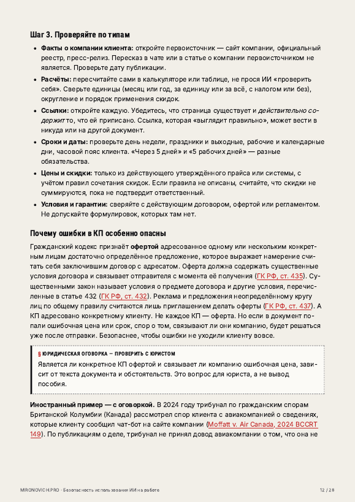 |
| 03 — юридическая оговорка и таблица «светофор» | 04 — оферта и иностранный пример с оговоркой |
| 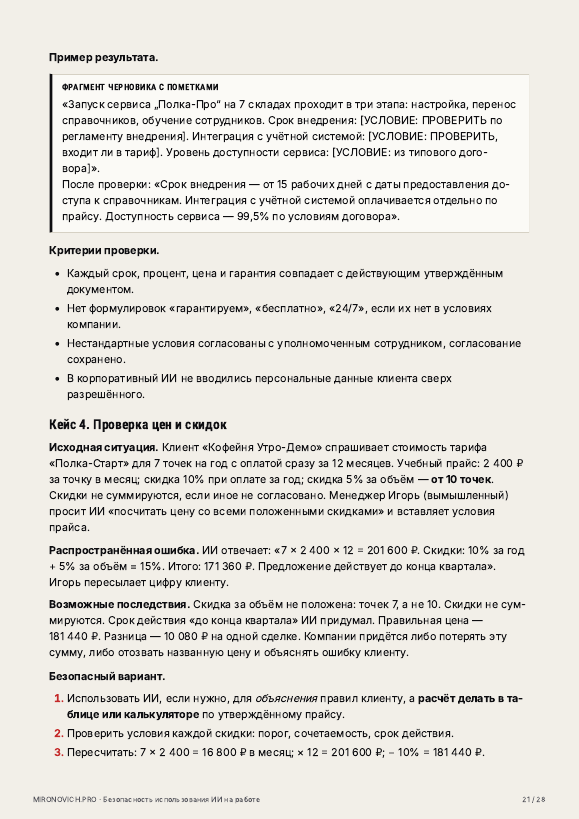 | 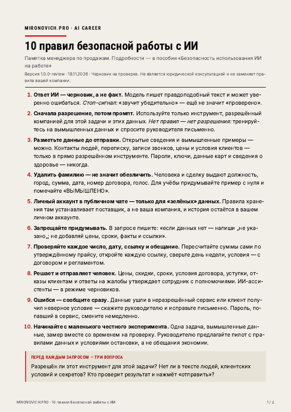 |
| 05 — кейс «Проверка цен и скидок» | 09 — памятка «10 правил», стр. 1 из 2 |

| Телефон (110×196 мм) | | |
| --- | --- | --- |
| 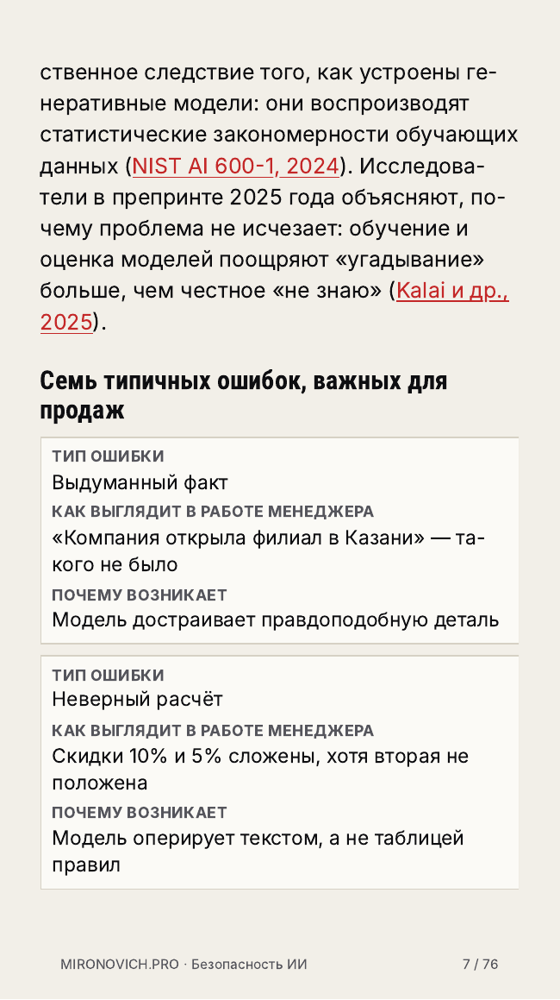 | 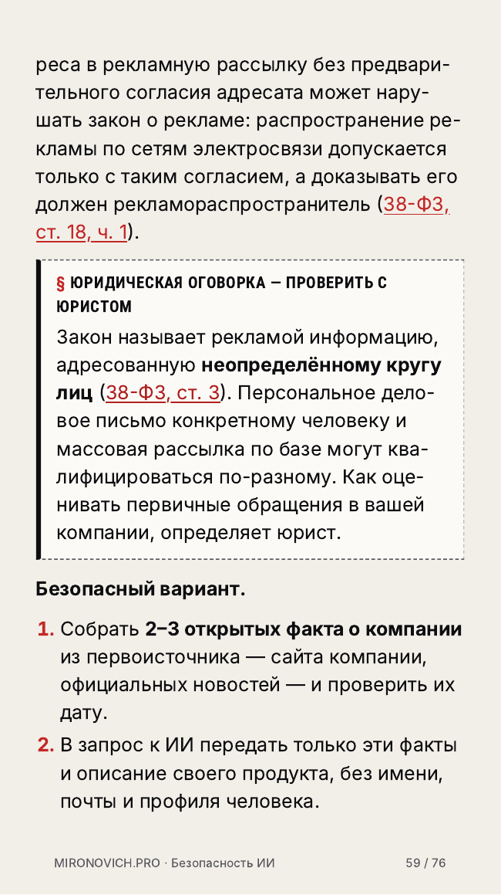 | 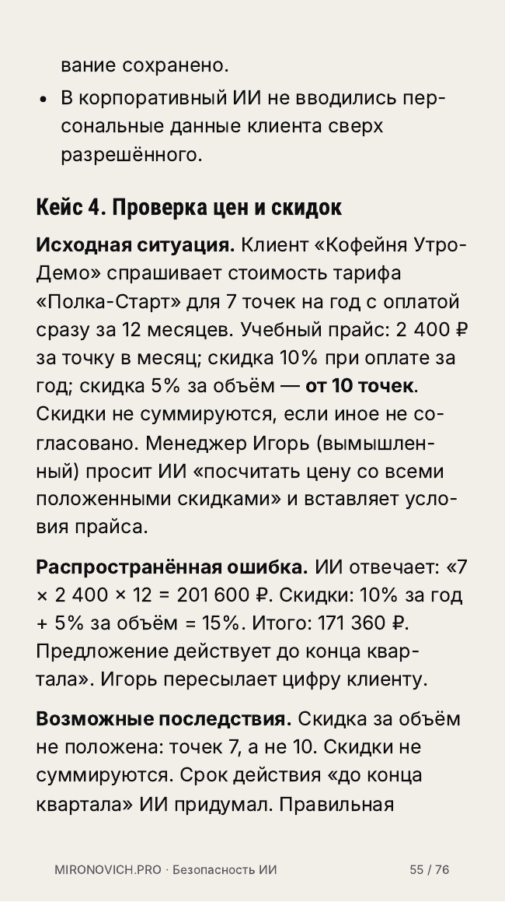 |
| 06 — таблица как карточки | 07 — юридическая оговорка | 08 — кейс |

| Рабочая тетрадь | |
| --- | --- |
| 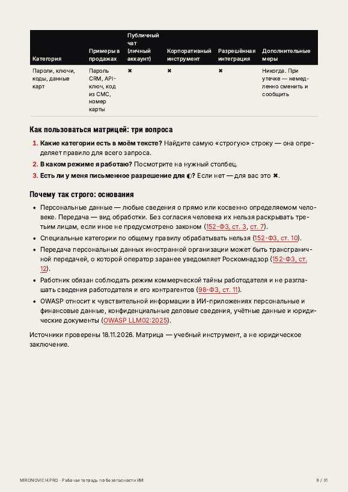 | 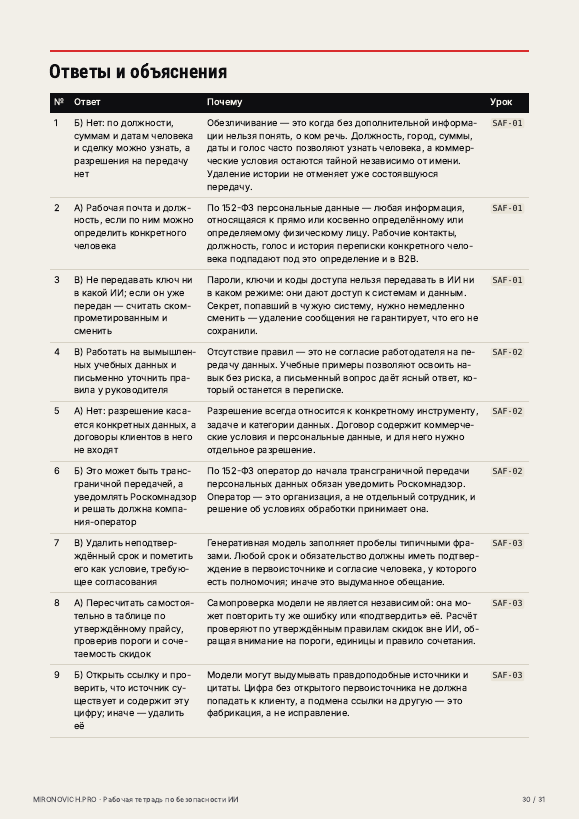 |
| 11 — матрица допустимости данных | 12 — ответы теста с объяснениями |

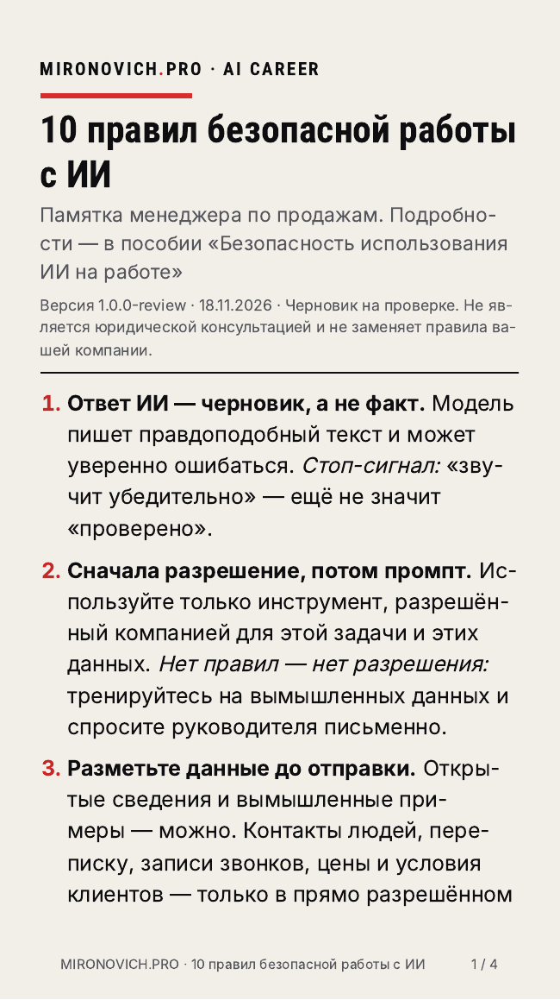

10 — памятка, версия для телефона.

## Ограничения проверки

- Проверка выполнялась рендером PDF в PNG (poppler), а не на физических устройствах. Перед запуском нужен просмотр на 1–2 реальных телефонах (iOS Files/Safari, Android Chrome/Drive).
- Скринридеры: PDF размечен как tagged (`tagged: true`), но совместимость с NVDA/VoiceOver не тестировалась.
- Воспроизводимость гарантирована для Chromium из Playwright 1.63.0; при обновлении браузера переносы и разбиение страниц могут сдвинуться — тогда PDF пересобираются и коммитятся заново.
