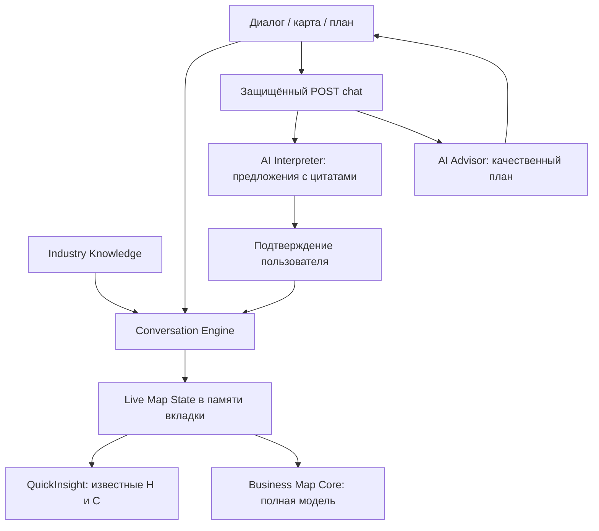

# Архитектура и технический аудит

База: `feature/business-map-preview`, `3bbf569b43c49f6d0cede6c235f6d3a45cfdba5b`. Ветка реализации: `feature/business-map-ai-dialog`. Main, production, PR №9 и инфраструктура Railway не изменяются.

## Аудит до реализации

Расчётное ядро `lib/business-map/` чистое, типизированное, с точной дробной арифметикой. `Process.operations` — общий объём команды. W-CAPACITY уже блокирует уверенный первый приоритет. Company требует категориальный контекст, поэтому нельзя вызывать полный расчёт на раннем описании, выдумывая headcount/goal/systems. UI этапа 2 хранит параметры в React state и содержит полезные редакторы, объяснения и демо, но стартует длинной анкетой.

Preview защищает весь origin Basic Auth; прежний middleware запрещает все API/POST. Требуется точечное исключение с независимой проверкой внутри route. Публичный `recommendation-api` имеет собственное согласование/конфигурацию: он не меняется и не используется для Business Map. `PublicSiteOnly` уже исключает публичные аналитику/формы из прототипа.

## Слои

| Компонент | Реализация и ответственность |
|---|---|
| Industry Knowledge | `dialog/industry.ts`: каталог семи фитнес-гипотез, вопросы, полезные действия, ограничения и метрики; универсальный fallback |
| Conversation Engine | `dialog/engine.ts`: чистые переходы состояния, вопросы, короткие ответы, unknown, выбор процессов, редактирование, подтверждение трактовки |
| AI Interpreter | `ai-orchestrator.ts` + `ai-schema.ts`: официальный Responses API, строгая схема, доказательные цитаты и неподтверждённые гипотезы |
| AI Advisor | отдельный intent `advise`, качественные поля плана; без финансовых чисел/оценок |
| Business Map Core | неизменённые `calculate.ts`, `decimal.ts`, `validation.ts`, `config/business-map-model.ts`; сценарии, стоимость, риск, матрица, приоритет |
| QuickInsight | `quick-insight.ts`: H/C через существующие Decimal/hours/timeCost/quantity, без фиктивного Company и обещания высвобождения |
| Live Map State | `dialog/contracts.ts`: частичные факты, исходный scope объёма, вопросы, процессы, полные результаты, неподтверждённая трактовка и актуальный план |
| API boundary | `chat-handler.ts`, route и точечное исключение middleware; Auth, schema, size, origin, budget, timeout, no-store |
| UI | `components/business-map/dialog/`: responsive основной диалог, библиотека, карта, быстрый редактор, план |

## Переиспользование

Переиспользованы точная арифметика и округление ядра; существующий полный расчёт и приоритизация; `CompanyForm`, `ProcessEditor`, `Analysis`, компоненты полей/представления и фирменная палитра/шрифты; синтетические fixtures этапа 2; `authorizePrototype`, `prototypeMode`, private response headers и ограниченный потоковый JSON reader. В `CompanyForm` добавлены фитнес и агентства и разрешена частичная инициализация уже известных полей. Старый `Prototype.tsx` сохранён; основной защищённый маршрут теперь рендерит диалог. Публичные калькуляторы не менялись.

## Контракты и границы расчёта

`Workload` хранит operations + scope team/per-person/unknown, сотрудников, период, минуты и необязательную ставку. Неизвестное — null; не ноль и не среднее. `QuickInsight` хранит Quantity|null для часов/стоимости, нормализованный teamOperations, пробелы, W-CAPACITY и первый практический шаг. Он не содержит процентов автоматизации, экономии или окупаемости.

`LiveProcess` отделяет confirmed, пользовательские сведения, гипотезы, исходный workload, категорию ошибки, пройденные вопросы и необязательный полный Process/ProcessResult. `ConversationState` хранит до пяти активных процессов, очередь выбора кандидатов, сообщения с источником, текущий вопрос, отдельную Interpretation для подтверждения и качественные Advice по ID. До Company и явного задания полей полный финансовый вход не создаётся.

Преобразование per-person → team выполняется до передачи в Core ровно один раз; после полного редактирования scope становится team. Независимость/пересечения сохраняются по правилам ядра; без проверки часы процессов не суммируются. W-CAPACITY влияет и на ранний статус, и на приоритет полного результата. Отказ от подтверждённой ранее проблемы убирает её расчётный приоритет. Изменение данных пересчитывает ядро, удаляет старый ИИ-план и защищено от запоздавшего ответа через revision/generation.

`ChatRequest` включает intent, сообщение, минимум контекста, scenarioId, question, risk и случайный requestId. `ChatResponse` явно различает OpenAI и unavailable. API не принимает готовые расчётные результаты. Числа из Interpretation — только предложения с цитатами; Advisor — только качественный план. Схемы отклоняют лишние поля.

Финансовая версия остаётся **business-map-v1.1**; коэффициенты не менялись. Диалоговые эксплуатационные лимиты версионированы отдельно в **business-map-dialog-v1**. Тексты и финансовая арифметика не зависят от модели.

Сохранение, аккаунты, server-owned snapshots и голос — будущие адаптеры, а не реализованные сервисы. Голос должен преобразовываться в `ConversationInput`; до дальнейшего этапа захвата аудио нет.

Реальный OpenAI-вызов не принят: ключ в рабочей среде отсутствует. См. [ai-integration.md](ai-integration.md), [security.md](security.md) и [qa-report.md](qa-report.md).

Для предложений Interpreter отдельно хранится `proposalSource`: режим демо не может изменить подпись последующего реального ответа и наоборот. Полный результат Core остаётся авторитетным для статуса и W-CAPACITY; слой отображения не переопределяет его собственным общим баллом. При W-CAPACITY план требует сверки нагрузки и не запрашивает заменяющее её объяснение ИИ.
