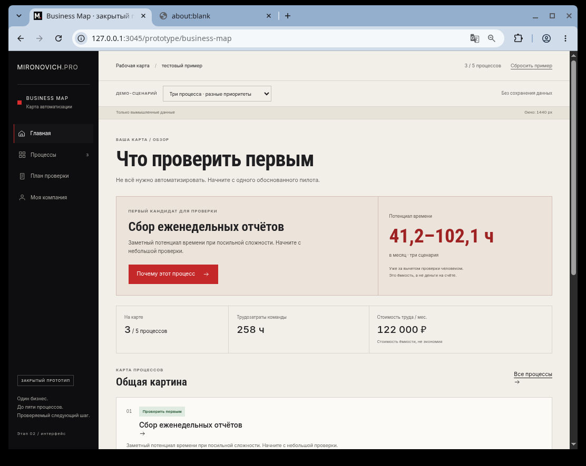
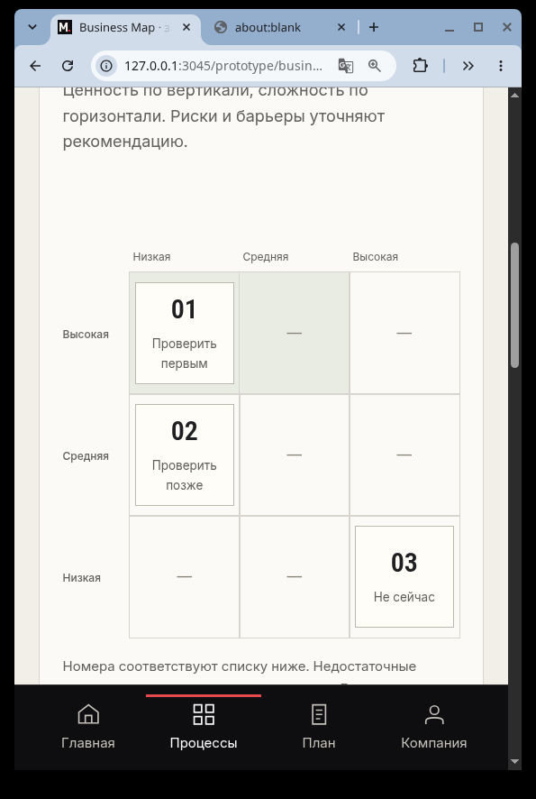
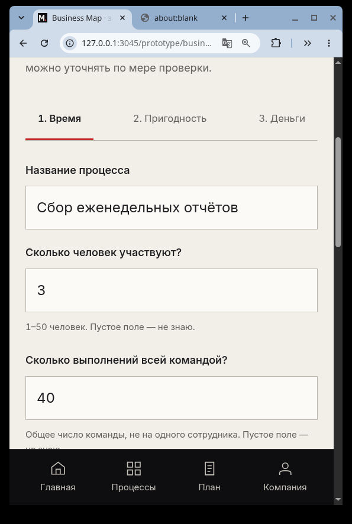

# Business Map — интерактивный прототип, этап 2

Ветка `feature/business-map-ui`, база `feature/business-map-core`, коммит этапа 1: `87718d648850b38215a25c6dc71482efa4cf828d`.

Это локальный закрытый прототип на синтетических данных для визуального обсуждения. Регистрация, БД, оплата и ИИ отсутствуют. Сайт не публикуется.

## Запуск

Node 22.x, зависимости проекта (`npm ci`), затем:

```sh
BUSINESS_MAP_PROTOTYPE=1 npm run dev -- --hostname 127.0.0.1 --port 3045
```

Открыть `http://127.0.0.1:3045/prototype/business-map`.

Локально обязательны `NODE_ENV=development` и `BUSINESS_MAP_PROTOTYPE=1`, без Railway environment. В обычной dev-среде без флага — 404. Для отдельного защищённого Railway Preview добавлен режим production build с Basic Auth: см. [параметры Preview](../preview/README.md). При Railway environment `production` страница всегда отвечает 404, даже при флагах и правильном пароле. В навигацию публичного сайта и sitemap прототип не добавлен. Это ограничение среды, а не замена будущей авторизации кабинета; не выставляйте dev-сервер в Интернет.

## Как посмотреть

1. На первом экране один вопрос — название процесса.
2. Затем четыре контекстных поля компании, без названия бизнеса, контактов и обязательной зарплаты.
3. Быстрый ввод: число участников, частота **всей команды**, период, минуты и источник цифры. После одного процесса сразу доступны часы и предварительный результат.
4. Вкладка «Пригодность» уточняет восемь параметров. Бумага/голос предлагают ручной доступ; неизвестные значения сохраняются неизвестными.
5. Вкладка «Деньги» необязательная: ставка, фонд, реальная отмена платежей, пять статей затрат, дополнительная ёмкость. Пустая статья не равна нулю, нулевые затраты вводятся `[0,0]` через оба поля.
6. На главной — первый обоснованный кандидат либо причины, почему выбирать рано. На карте — до пяти процессов, редактирование и отдельная матрица.
7. Анализ процесса показывает ввод [Ф], формулы [Р], допущения [Г], три сценария, остаточный труд, FTE, риски, уверенность и окупаемость.
8. План доступен для первого рекомендуемого процесса. Гипотеза, ответственный, выборка, критерии продолжения/остановки и результаты редактируются в памяти вкладки.

В селекторе доступны: три процесса с разными приоритетами, недостаточные данные, высокий риск, отсутствие окупаемости, превышенный фонд. Переключение демо заменяет текущую карту. При пяти процессах добавление блокируется; отдельный процесс можно удалить из анализа, чтобы освободить слот.

## Состояние и данные

Все введённые параметры находятся только в React state. Нет localStorage, sessionStorage, IndexedDB, cookie с анкетой, сетевой отправки формы или журналирования значений. Перезагрузка очищает карту. Нажатие «Отменить» отменяет несохранённое редактирование процесса; сохранённые процессы не требуют повторного прохождения анкеты. Переключение между разделами сохраняет карту и правки плана до обновления вкладки.

`PublicSiteOnly` не монтирует на маршруте прототипа публичные Analytics, attribution, баннер согласия, меню и footer. Публичные страницы и калькуляторы сохраняют прежние компоненты и поведение. Общая очистка URL и проверка статуса согласия корневого layout остаются, но данные анкеты туда не передаются.

## Расчёты и исправление W-CAPACITY

Единственный расчётчик — `lib/business-map/`. UI форматирует готовые числа и показывает формулы; собственных финансовых коэффициентов, суммирования эффектов и оценок ИИ нет.

Версия правил повышена до `business-map-v1.1`. Все математические допущения v1 сохранены. Изменилось правило достоверности: при `H > сотрудники × личный месячный фонд` уверенность становится низкой; появляются `R-CAPACITY` и `missing.workloadCapacity`. Матрица по-прежнему видна, но позиция first становится preliminary. `recommendedId` отсутствует, план уверенного первого пилота не открывается. Расчётные H/F/C не уменьшаются и не подгоняются под фонд.

Причина: измеренные значения, противоречащие физическому рабочему фонду, требуют сверки. Граница использует уже существующий фонд h, без нового финансового порога. Регрессионный тест проверяет 166,2 ч при фонде 165 и точную границу 165, где рекомендация остаётся допустимой.

## Артефакты и ограничения

- `qa-report.md` — проверки, найденные проблемы и оценка удобства.
- `screenshots/` — 21 реальный снимок Chromium при ширинах 375, 768 и 1440 CSS px.
- `gallery.html` — автономная галерея снимков без внешних ресурсов.

Прототип использует один URL и переключает экраны в памяти: Главная, Процессы, Анализ, Компания, Форма и План. Ссылок на сохранённые анализы, истории, аккаунтов и восстановления после перезагрузки нет. Это намеренное ограничение этапа, не реализация кабинета. Для реальных данных и совместного доступа нужен отдельный следующий этап с серверной принадлежностью данных и политикой хранения.

## Визуальный просмотр

Обзор на 1440 CSS px:



| Матрица на 375 CSS px | Форма на 375 CSS px |
| --- | --- |
|  |  |

[Все снимки](screenshots/) · [Автономная HTML-галерея](gallery.html) · [Отчёт об удобстве](qa-report.md). HTML-галерею можно скачать и открыть локально: снимки встроены, внешних запросов нет.
