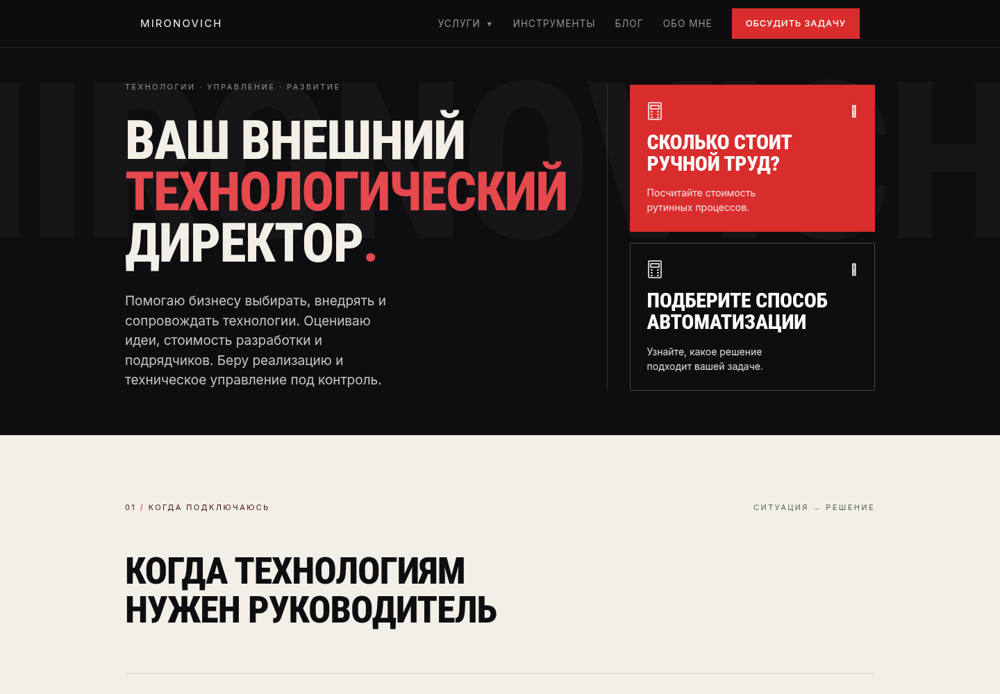
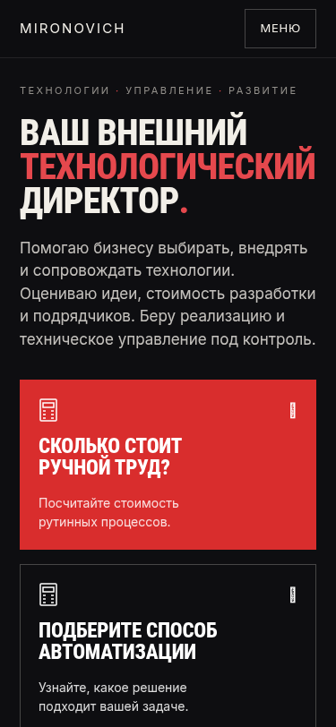

# Полный предпросмотр MIRONOVICH.PRO перед релизом

Проверка выполнена 7 ноября 2026 года на production-сборке ветки
`content/cto-articles-wave1`, исходный SHA
`ed169ce0d3f1a8b4ee107ef0c22994e41b43b675`.
До начала работы локальный HEAD, удалённая ветка и `refs/pull/5/head` совпадали;
рабочее дерево было чистым. Предыдущие этапы повторно не переносились, stash не применялся.

[Draft PR #5](https://github.com/mironovich2345-code/mironovich.pro/pull/5).
Коммит этого отчёта содержит только README и реальные скриншоты Chromium.
Код, контент сайта, формулы, юридические документы, зависимости и настройки инфраструктуры не изменялись.

## Предпросмотр и способ проверки

Production-сервер запущен внутри среды Codex на порту 3000 командой `npm start`.
Локальный адрес — `http://localhost:3000`; это **не внешняя preview-ссылка**.
Сервер оставлен запущенным на время существования сессии.

В доступном наборе инструментов нет выдачи публичного URL или проброса порта.
Среда `ccarenv_b64_Y2NhcmVudl9lZGUxY2ExOTlkOTQ4MTkxYjQwMDVjOTM1Mzg3OTRiNA`
сообщает `running`, `connected`, `observations_current: true`;
для remote desktop — `enabled: true`, `state: unknown`.
Инструменты `open_in_codex`, `cua_repl.js` и управления общим браузером отсутствуют.
Поэтому использован предусмотренный заданием вариант: локальный Chromium через Playwright,
скриншоты в GitHub и этот отчёт. Публичный URL не создавался.

Для проверки форм сервер запущен с отдельными тестовыми значениями Telegram и локальной
заглушкой доставки. Она перехватывает тестовый Telegram endpoint и блокирует остальные
обращения к Telegram. Рабочие секреты и настройки Railway не читались в отчёт и не менялись.
Две заявки прошли настоящий локальный `/api/lead`, но **реальных сообщений в Telegram не было**.
Ошибки 429 и 502 дополнительно воспроизводились через браузерные заглушки.
Перед использованием этого preview нужно учитывать: его формы не доставляют настоящие заявки.

Проверялись ширины **320, 375, 768, 1024 и 1440 px**. Высота окна — 812 px на узких
экранах и 1000 px на остальных. Это эмуляция размеров в Chromium, а не проверка на физических
телефонах, Safari или Firefox.

## Технические результаты

| Проверка | Результат |
| --- | --- |
| `npm test` | 148 прошли; 0 ошибок, 0 пропусков |
| `npm run lint` | ESLint прошёл, `--max-warnings=0` |
| `npm run typecheck` | TypeScript прошёл, `tsc --noEmit` |
| `npm run build` | Production build прошёл; 56/56 статических страниц сгенерированы |
| Страницы в браузере | 17 маршрутов × 5 ширин = 85 проверок; HTTP 200, по одному H1 |
| Горизонтальное переполнение документа | Не обнаружено в 85 проверках, включая узкий футер |
| Внутренние ссылки и якоря | 49 целей, 362 связи «страница → ссылка»; битых — 0 |
| Ошибки JavaScript | 0 |
| Неожиданные ошибки консоли | 0; отдельно получены 2 ожидаемые HTTP-ошибки при имитации 429/502 |
| Денежная модель автоматизации | `approvedByOwner: false`, `publicPricingEnabled: false` |

Использованы Node.js 22.23.4, npm 11.9.0, Next.js 15.5.28.
Сборка выполнена обычной командой `npm run build`, без обхода release guard.

### Предупреждения существующей конфигурации

Сборка успешно завершилась с уже существующими предупреждениями:

- Действует решение владельца от 2026-11-01 о выпуске с прежними `/privacy` и `/consent`.
  Они не полностью описывают текущие сервисы и сроки хранения. Новые проекты юридических
  документов содержат незаполненные поля и остаются неопубликованными.
  Это ранее принятое исключение, описанное в `docs/release/go-no-go.md`, а не новая ошибка
  предпросмотра. Документы в этой работе не менялись.
- В этой среде `RATE_LIMIT_CLIENT_IP` не задан: включён общий лимит 10 заявок в минуту,
  индивидуальный лимит по IP выключен до проверки на staging.
  Конфигурация production Railway и работа за его прокси в этой проверке не подтверждались.

Успешная сборка не заменяет юридическую проверку и решение владельца о публикации.

## Проверенные страницы

Каждая строка проверена на всех пяти ширинах. «Готова к приёмке» означает отсутствие
обнаруженного технического препятствия, а не автоматическое разрешение на production deploy.

| Маршрут | Результат и замечания |
| --- | --- |
| `/` | Готова к приёмке; замечание V2 к символу на карточках инструментов |
| `/services` | Готова к приёмке; V1 к заголовку на 320 px |
| `/services/cto` | Готова к приёмке; небольшое отклонение от внутреннего отступа на 320 px, V1 |
| `/services/development` | Готова к приёмке |
| `/services/support` | Готова к приёмке |
| `/services/expertise` | Готова к приёмке |
| `/tools` | Готова к приёмке; V2 на общих карточках инструментов |
| `/tools/labor-cost` | Все шаги и результат работают; готова к приёмке |
| `/tools/automation-cost` | Все шаги, диагностика и план работают; V1 и V3 |
| `/blog` | Готова к приёмке; карточки с обложками и без них отображаются |
| `/blog/kogda-nuzhen-vneshniy-cto` | Готова к приёмке |
| `/blog/razrabotchik-ushel-kak-prinyat-proekt` | Готова к приёмке |
| `/blog/skolko-stoit-ruchnaya-otchetnost` | Готова к приёмке |
| `/blog/kak-proverit-smetu-razrabotchika` | Готова к приёмке |
| `/blog/kogda-ii-biznesu-ne-nuzhen` | Готова к приёмке |
| `/about` | Дополнительная проверка; готова к приёмке |
| `/contact` | Дополнительная проверка; валидация и согласие работают |

### Главная, услуги, навигация и блог

- Первый экран содержит «Ваш внешний технологический директор», описание роли и обе
  ссылки на калькуляторы. Блоки услуг, преимуществ, CTA и подвал доступны.
- Четыре основных направления различаются по роли: CTO — решения и координация;
  разработка — реализация; сопровождение — эксплуатация; экспертиза — независимая проверка.
  Следующий шаг для обращения обозначен, бесплатный первый контакт отделён от подробного разбора.
- Главное позиционирование согласовано между главной, услугами и навигацией.
  Более узкие направления автоматизации, приложений и обучения, а также старые темы блога
  остаются дополнительными специализациями, не подменяя основное предложение.
- Основные CTA на главной, странице услуг и четырёх страницах направлений приводят к форме.
  Форма видима; плавающая кнопка не перекрывает её. Ссылка Hero на калькулятор открывается с клавиатуры.
- Мобильное меню проверено на 320/375/768 px: открытие, закрытие, блокировка прокрутки,
  Tab/Shift+Tab, Escape с возвратом фокуса, закрытие после перехода.
  Выпадающее меню услуг проверено на 1024/1440 px, включая Escape и переход.
- У пяти статей проверены заголовки, структура текста и содержания, CTA, ссылки и адаптация.
  В списке блога карточки без обложек сохраняют самостоятельный текстовый вид.
  Все 17 видимых обложек на десктопе загрузились. На мобильном они намеренно скрыты CSS;
  это поведение макета, а не сломанная загрузка изображений.

### Калькуляторы и формы

- Оба опроса полностью пройдены на каждой из пяти ширин. Проверены пустой ответ,
  сообщения об ошибках, «Назад», «Продолжить», сохранение ответов и редактирование.
  Постоянной пустой области ошибок нет.
- Ручной труд: сохранён пример **66 ч и 39 600 ₽/мес**, потенциально освобождаемые 33 ч.
  Основной красный CTA один, консультация оформлена вторичным действием.
- Перенос из первого калькулятора во второй сохраняет исходные числовые данные.
  Пройдены семь шагов автоматизации, варианты интеграции и работы ИИ с базой знаний,
  цели, системы, последствия ошибки и возврат для изменения ответов.
- Все пять секций экспресс-плана изначально закрыты. Они открываются клавишей Enter,
  могут оставаться открыты одновременно, закрываются пробелом; фокус сохраняется.
  Проверены шесть шагов плана и пять проверок готовности.
- В сценарии ИИ с серьёзными последствиями ошибки результат требует контроля человеком,
  даже если соответствующий флажок пользователь не выбрал. Автономный запуск не обещается.
- CTA «Запросить подробный разбор» открывает доступную форму с фокусом на имени.
  Поле задачи редактируемое; описание «Другой задачи» переносится в него.
  При смене типа задачи прежнее описание удаляется. До явной отправки и согласия POST
  отсутствует; текст задачи не оказывается в URL или браузерном хранилище.
- Две тестовые отправки через локальный API подтвердили серверный пересчёт, передачу
  контекста и плана, экранирование тестовой разметки, контроль человека и first-touch UTM.
  Реальная внешняя доставка заменена заглушкой.
- При 429 и ошибке доставки форма показывает понятное сообщение, сохраняет введённое
  и предлагает альтернативный контакт. На `/contact` пустая отправка фокусирует имя;
  диалог согласия открывается и закрывается Escape. Без согласия заявки не отправляются.

## Визуальные замечания — без автоматических исправлений

Критических ошибок, препятствующих запуску preview или прохождению проверенных сценариев,
не обнаружено. Следующие замечания оставлены владельцу для решения; код не исправлялся.

### V1. Заголовки на ширине 320 px уменьшают правый внутренний отступ

На `/services` текст H1 заканчивается примерно на x=319 при расчётной границе контента
x=298. На `/services/cto` — x=302 при границе x=298. В первом вопросе калькулятора
автоматизации текст H2 доходит до x=296 при границе текста x=277 и правом крае карточки x=298.
Слова остаются в пределах экрана, глобального горизонтального скролла нет, но на 320 px
заголовки выглядят тесно. Предложение для последующего согласования: проверить переносы
и размер этих конкретных заголовков на минимальной ширине.

[Услуги, 320 px](issue-services-heading-320.png) ·
[CTO, 320 px](issue-cto-heading-320.png) ·
[Вопрос, 320 px](issue-wizard-heading-320.png).

### V2. Символ ↗ в карточках инструментов плохо читается

В текущем Chromium символ в правом верхнем углу карточки выглядит узким вертикальным
знаком. Текст и переход работают. Причина рендеринга или подстановки глифа не подтверждена;
это визуальное наблюдение. После согласования можно отдельно проверить глиф либо использовать
иконку с предсказуемым отображением.

[Фрагмент карточки](tool-card-arrow.png) · [Первый экран](home-hero-desktop.png).

### V3. Мобильный результат автоматизации можно сделать компактнее

После перехода к результату его верх находится на y=168 при нижней границе шапки y=65:
между ними остаётся около 103 px. В окне 375×812 CTA подробного разбора начинается на
y=1094 в сценарии интеграции и y=1055 в сценарии ИИ. Кнопка доступна прокруткой, но
не видна сразу после расчёта. Предложение для согласования: уменьшить отступ при прокрутке
к результату и оценить более раннее расположение CTA, сохранив диагностику и пять секций.

[Настоящий viewport 375×812](automation-result-mobile-viewport.png) ·
[Полный результат](automation-result-mobile.png).

## Скриншоты

Все изображения получены из работающего локального production preview.
Desktop — 1440 px, mobile — 375 px, кроме явно обозначенных примеров на 320 px.
Полностраничные изображения включают нижние блоки; снимки результатов показывают карточку
целиком с сохранением ширины. Для оценки первого экрана есть отдельные viewport-снимки.
В формах нет реальных заявок, действующих токенов или тестовых контактных данных.

### Восемь основных снимков

| Страница | Скриншот |
| --- | --- |
| Главная, desktop | [Открыть полный снимок](home-desktop.png) |
| Главная, mobile | [Открыть полный снимок](home-mobile.png) |
| Внешний CTO, desktop | [Открыть полный снимок](service-cto-desktop.png) |
| Услуги, mobile | [Открыть полный снимок](services-mobile.png) |
| Результат ручного труда | [Desktop](labor-result-desktop.png) |
| Результат автоматизации | [Desktop](automation-result-desktop.png) |
| Блог, desktop | [Открыть полный снимок](blog-desktop.png) |
| Блог, mobile | [Открыть полный снимок](blog-mobile.png) |

### Дополнительные снимки

- [Разработка — desktop](service-development-desktop.png).
- [Сопровождение — desktop](service-support-desktop.png).
- [Экспертиза — desktop](service-expertise-desktop.png).
- [Ручной труд — мобильный результат](labor-result-mobile.png).
- [Автоматизация — мобильный результат ИИ с серьёзным риском](automation-result-mobile.png).
- [Автоматизация — результат в реальном мобильном окне](automation-result-mobile-viewport.png).
- [Все пять секций плана раскрыты на мобильном](automation-expanded-mobile.png).
- [Форма подробного разбора на мобильном](automation-form-mobile.png).
- [Мобильное меню и фокус клавиатуры](mobile-menu.png).
- [Услуги: заголовок на 320 px](issue-services-heading-320.png).
- [CTO: заголовок на 320 px](issue-cto-heading-320.png).
- [Опрос: заголовок на 320 px](issue-wizard-heading-320.png).
- [Символ на карточке инструмента](tool-card-arrow.png).

Всего сохранено 23 PNG. Сырые журналы, тестовые заглушки, JSON браузерных прогонов
и временные файлы в GitHub не включены.

## Рекомендация

Версия технически готова к визуальной приёмке владельцем: перечисленные 17 страниц открываются,
калькуляторы и формы проходят проверенные сценарии, тесты и production build успешны.
Для просмотренных маршрутов блокирующих дефектов не найдено; V1–V3 — некритические улучшения.

Решение о публикации следует принять после просмотра скриншотов и подтверждения текстов,
включая фактические даты выхода новых статей: 2026-11-07 в ветке отражает дату подготовки.
Существующее юридическое исключение сохраняется; production-доставка Telegram,
конфигурация Railway и физические устройства этой проверкой не подтверждены.
Merge, production deploy и изменения Railway не выполнялись.
